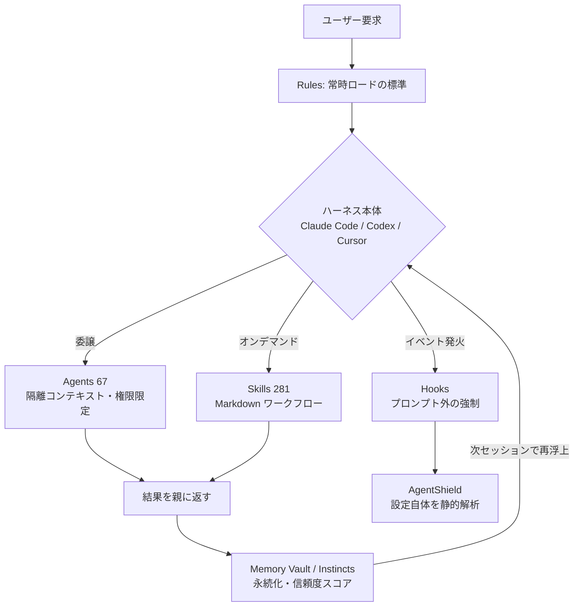

# Everything Claude Code (ECC)

> [!info] 調査メタ情報
> - リポジトリ: [affaan-m/ECC](https://github.com/affaan-m/ECC)（旧 `affaan-m/everything-claude-code` — 旧 URL はリダイレクトされる）
> - 調査日: 2026-08-05 / 対象バージョン: v2.1.0（2026-07-27 リリース）
> - ライセンス: MIT / 公式サイト: [ecc.tools](https://ecc.tools)

## 1. 要約

ECC は「AI コーディングエージェントを**その場の即興**から解放し、**計画 → テスト → 実装 → レビュー → 検証 → 記憶 → 改善**という決まった手順の上で走らせる」ための設定・スキル・エージェント群を丸ごとパッケージ化した OSS である。作者自身は「エージェントハーネス性能最適化システム（agent harness performance optimization system）」と呼び、README では "The Agent Harness Operating System" と名乗る。

Claude Code だけでなく Codex・Cursor・OpenCode・Gemini・Kimi など十数種のハーネスに同じ資産を配布できる「横断基盤」を志向している点が最大の特徴。2026-01-18 の公開から約 7 か月で ⭐237,716 / fork 36,117（2026-08-05 時点、GitHub API 実測）という異常な速度で伸びた一方、「大半の開発者には過剰では」という批判も同じくらい大きい、賛否の割れるプロジェクトでもある。

## 2. これは何のためのプロダクトか

### 解こうとしている問題

README が挙げる問題意識は次の 3 点に集約される。

1. **検証がない** — エージェントはコードを書けるが、体系的な検証・品質ゲートがない。「まず生成して、あとから検証を足す」という順序が常態化している。
2. **記憶がない** — セッションが終わると学習が消える。毎回ゼロから文脈を組み立て直している。
3. **視点が固定される** — 同一コンテキストで書き続けるため、盲点を別視点でチェックする仕組みがない。

### 核心的な主張

ECC のアーキテクチャ哲学は README の一文に凝縮されている。

> [!quote] 設計原則
> **"Optimize the context window. Persist everything else."**
> （コンテキストウィンドウは最適化せよ。それ以外はすべて永続化せよ。）

つまり「モデルに毎回すべてを読ませる」のではなく、

- スキルは**必要になった時だけ**ロードする（オンデマンド）
- 学習した振る舞いは**外部に永続化**する（instincts / memory vault）
- 強制力のあるルールは**プロンプトの外**（hooks）で実行する

という三層分離でコンテキスト消費を抑える、という主張である。

### 作者と成り立ち

作者は Affaan Mustafa 氏。2025 年 9 月の Anthropic × Forum Ventures ハッカソン（NYC）で優勝したチームの一員で、10 か月以上にわたり実プロダクト開発で Claude Code を日常使用する中で溜め込んだ個人設定を、2026 年 1 月に OSS 化したものが出発点とされる。現在も実質的に単独メンテナが週次でリリースを回している（と見られる）。

## 3. 何ができるのか

v2.1.0 時点でリポジトリに含まれる資産は以下（2026-08-05 に GitHub API でディレクトリ件数を実測）。

| 資産 | 件数 | 役割 |
| --- | --- | --- |
| `skills/` | **281** | オンデマンドで読み込まれる再利用可能ワークフロー |
| `agents/` | **67** | 権限を絞ったサブエージェント（別コンテキストで動く） |
| `commands/` | **94** | スラッシュコマンド（現在は旧互換シム扱い、新規開発はスキル側） |
| `rules/` | **23** ディレクトリ | 常時ロードされるコーディング標準（`common/` + 言語別パック） |
| `hooks/` | — | セッション/ツール実行イベントで発火する強制スクリプト |

### 主要コンポーネント

- **Skills（281）** — TDD ワークフロー、セキュリティレビュー、E2E テスト、フレームワーク別パターン（Django / Spring Boot / FastAPI / Next.js / Laravel など）、ML エンジニアリング、ドキュメント・リサーチ系まで。Claude Code が要求内容から自動選択する。
- **Agents（67）** — `planner`（設計）、`code-reviewer`（フレッシュな文脈でのレビュー）、`security-reviewer`、`architect`、`build-error-resolver`、および言語別レビュアー（Go / Python / TypeScript / Java / Rust / Kotlin / Swift / C++ / C# / F# / PHP など）。
- **Rules（23 パック）** — `common/`（テスト・セキュリティ・Git ワークフロー等の普遍原則）に加え、`typescript/` `python/` `golang/` `rust/` `swift/` `arkts/` `vue/` `nuxt/` `react-native/` など言語・スタック別。**選択インストール**でコンテキスト消費量を制御できる。
- **Hooks** — ファイル編集・ツール実行・セッション開始/終了で発火。`console.log` の混入阻止、TypeScript 型チェック強制、プロンプトへの秘密情報混入ブロック、tmux 外での dev server 検出、セッション状態の自動保存など。**モデルの気分に依存しない強制力**をここで担保する。
- **Continuous Learning v2 / Instincts** — セッションから振る舞いパターンを抽出し、**信頼度スコア付きの「instinct（本能）」**として保存。次回以降のセッションで関連する instinct が再浮上する。`/instinct-status` で状態確認、`/evolve` で近い instinct をクラスタリングして新しいスキル・エージェント候補に昇格させる。
- **Unified Memory Vault** — `.ecc/memory/` 配下にポータブルな Markdown 形式で文脈を永続化。Claude / Codex / Hermes / Kimi 間でコンテキストを作り直さずに引き継げる、というのが売り。
- **AgentShield** — エージェント設定**そのもの**を監査するセキュリティスキャナ。プロンプト、hooks、MCP 設定、権限、シークレット、エージェント定義ファイルを対象に**102 の静的解析ルール**を適用。14 種のシークレットパターンを検出し、CI で critical 検出時に exit code 2 を返す。`-opus` フラグで red team / blue team / auditor の 3 エージェントによる敵対的分析パイプラインを起動できる（README 記載: 1282 テスト / カバレッジ 98%）。
- **Plan Canvas（v2.1.0 新規）** — ループバック限定のブラウザ UI で計画を視覚的にレビューする機能。セクションをクリックして注釈、エージェントとチャット、承認してから実装へ進む。

### 対応ハーネス

リポジトリ直下には `.claude` `.codex` `.cursor` `.gemini` `.zed` `.opencode` `.qwen` `.kimi` `.hermes` `.openclaw` `.trae` `.kiro` `.codebuddy` `.agents` といったハーネス別ディレクトリが並ぶ。インストールは対象とプロファイルを指定する形式（例: `./install.sh --target cursor --profile minimal`）。Claude Code は plugin marketplace 経由が推奨。

## 4. どうやって実現しているのか

### アーキテクチャの骨子

実装上の勘所は次のとおり。

1. **すべてが Markdown** — スキルもエージェントもルールも実体は Markdown ファイル。エージェント定義にはツール allowlist とスコープ付きシステムプロンプトが宣言される。実行基盤を自前で持たず、各ハーネスの**ネイティブ設定機構**（plugin / agents / hooks 仕様）に流し込む形を取る。これがマルチハーネス対応を安価にしている反面、ハーネス側の仕様変更に追従し続ける必要を生んでいる。
2. **コンテキスト予算の制御** — スキルの遅延ロード、ルールの選択インストール、`MAX_THINKING_TOKENS` の上限設定、早期コンパクション（95% ではなく 50% 到達時）など、トークン消費に直接効く運用ノブが README に明文化されている。
3. **強制をモデルの外に置く** — 「LLM に『console.log を書くな』と頼む」のではなく、PostToolUse hook で機械的にブロックする。品質の再現性をプロンプト工学ではなくランタイムで担保する設計。
4. **MCP は最小主義に転換** — CHANGELOG によれば、2026-06 の監査を経てデフォルト MCP コネクタは `chrome-devtools` の 1 本のみに削減された。従来デフォルトだった 6 本（`github` `context7` `exa` `memory` `playwright` `sequential-thinking`）は、CLI/REST を包むスキルやハーネスのネイティブ機能で代替できるとして opt-in に降格している。**MCP を増やすほど良い、という潮流に逆行する判断**として注目に値する。
5. **ecc2/（Rust 製コントロールプレーン）** — リポジトリには Rust で書かれた `ecc2/` があり、`ecc-tui` として `dashboard` / `start` / `sessions` / `status` / `stop` / `resume` / `daemon` を提供する。ただし CHANGELOG 自身が「alpha の control-plane scaffold であり GA ではない」と明記している。

### トークン最適化の具体的な主張

README が挙げる数値目標（いずれも**作者側の主張**であり、第三者ベンチマークではない点に注意）:

- Opus → Sonnet への切り替えで、タスクの 80% 以上について**約 60% のコスト削減**
- `MAX_THINKING_TOKENS` を 10,000 に制限することで隠れた thinking コストを**約 70% 削減**
- コンテキスト 50% 時点での早期コンパクションが長時間セッションの品質を改善

## 5. 類似プロジェクト比較

> [!warning] 数値の鮮度について
> 以下の他プロジェクトの star 数は比較記事（EveryDev.ai / re:cinq / claudefa.st、2026 年前半〜中盤）由来で、**確認日が揃っていない**。ECC のみ 2026-08-05 の API 実測値。順位付けの根拠には使えるが、絶対値の比較には向かない。

| プロジェクト | 思想 | 規模感 | 永続メモリ | セキュリティ監査 | マルチハーネス | 導入コスト |
| --- | --- | --- | --- | --- | --- | --- |
| **ECC** | 全部入りの「エージェント OS」。標準化と横断移植性 | 281 skills / 67 agents / ⭐237K | ○（instincts + memory vault） | ◎（AgentShield 102 ルール） | ◎（13+ ハーネス） | 高 |
| **Superpowers** | TDD 規律をエージェントに適用。毎タスク新規サブエージェントで context rot 回避 | ⭐176K 級 | △ | × | △ | 中 |
| **BMAD-METHOD** | 「vibe coding のアンチテーゼ」。PRD・アーキ設計・ユーザーストーリーを真実の源に | ⭐46K 級 / 最古参 | ドキュメント経由 | × | ○（CC / Cursor / Windsurf） | 中〜高 |
| **Claude Flow / Ruflo** | 60+ ワーカーによるスウォーム並列実行。SQLite 永続メモリ、Byzantine コンセンサス | ⭐35K 級 | ◎（SQLite） | × | △ | 高 |
| **SuperClaude** | 意図的に軽量。約 30 コマンド + 20 エージェント。`pip install` で完結 | 小 | × | × | △ | 低 |
| **gstack** | ソロ創業者向け「ソフトウェア工場」。技術より先にビジネス制約を問う | ⭐88K 級 | △ | × | △ | 低〜中 |
| **GSD** | 反エンタープライズの軽量派。並列ウェーブ実行 | ⭐59K 級 | 単一 state ファイル | × | △ | 低 |
| **素の Claude Code** | フレームワークなし | — | ネイティブ機能のみ | × | — | ゼロ |

### 位置づけの整理

- **ECC は「広さ」で他を圧倒する** — セキュリティ監査（AgentShield）、クロスハーネス移植性、instinct による自己学習の 3 点を同時に持つのは現状 ECC だけと見られる。
- **深さでは専門特化型に劣る場面がある** — 純粋な並列実行なら Claude Flow、ブラウンフィールドの巨大レガシー改修なら BMAD の sharding、TDD 規律の徹底なら Superpowers、というように、単一制約に対する最適解は別にある。
- **「何も使わない」が正解のケースは多い** — 比較記事の共通結論は「1 セッションに収まり、自分が張り付いていられるタスクにフレームワークは不要」。EveryDev.ai が引用する Chase AI のホワイトボードベンチマーク（20 分 / 200K トークン）では、**テスト対象 3 フレームワークすべてに対して素の Claude Code が勝った**とされる（※このテストに ECC は含まれていない）。

## 6. 新規性・革新性

既存手法との差分として明確に新しいのは次の 3 点。

1. **エージェント設定を「攻撃対象」として静的解析する（AgentShield）**
   プロンプトインジェクション、悪意ある hook、MCP 設定の危険な権限、エージェント定義に埋まったシークレット — つまり**コードではなくエージェントハーネスそのものの脆弱性**を CI で検査するという発想。102 ルール + 敵対的 3 エージェントパイプラインという実装まで到達している OSS は他に見当たらない。

2. **信頼度スコア付き instinct と、スキルへの昇格経路**
   「セッションから学ぶ」だけなら他にもあるが、ECC は学習物に信頼度を持たせ、`/evolve` で複数の instinct をクラスタリングして**再利用可能なスキル定義に昇格させる**という明示的なライフサイクルを持つ。学習 → 蒸留 → 資産化の経路が製品機能になっている。

3. **ハーネス非依存のポータブル記憶**
   `.ecc/memory/` を Markdown で持ち、Claude Code で始めた作業を Codex や Kimi で継続する、という移植性を第一級の要件として設計している。多くの競合は特定ハーネス（多くは Claude Code）に紐づく。

一方で、**個々の構成要素は新発明ではない**点は正直に押さえておきたい。サブエージェント委譲も hooks もスキルも Claude Code のネイティブ機能であり、ECC の貢献は「それらを実運用で回るセットに組み上げ、標準として配ったこと」にある。革新はアーキテクチャよりも**キュレーションと配布**の側にある、と見るのが妥当。

## 7. 差別化ポイント

### 勝ち筋

- **標準化の外部化** — チーム内で「AI にどう書かせるか」を毎回議論する代わりに、既製の参照アーキテクチャを持ち込める。オンボーディング摩擦の低減効果が支持者から最も評価されている点。
- **ロックインの回避を売りにできる** — マルチハーネス対応は「特定のベンダーに賭けたくない」組織にとって実利がある。
- **セキュリティが差別化軸として効く** — エージェント設定の監査は企業導入時に確実に問われる領域で、ここに既製の答えがあるのは強い。
- **MIT・永久無償の明言** — 収益は ECC Pro（プライベートリポジトリ向けホスト型 GitHub App）とスポンサーで賄い、コアは MIT のままと宣言している。スポンサーには CodeRabbit、Greptile、Atlas Cloud、Moonshot AI (Kimi)、Itô Markets が名を連ねる。

### トレードオフ

- **習得コストが高い** — 67 エージェント / 281 スキルの全体像を把握するのに時間がかかる。「使わない機能のためのメンテナンス」を抱えやすい。
- **更新頻度が高すぎる** — 直近 8 週間の週次コミット数は `105, 20, 47, 22, 9, 11, 57, 19`（API 実測）。追従コストが常時発生する。
- **バス係数** — 単独メンテナが 7 ハーネス分を週次で回している構造は、コントリビューター 100 名超がいても脆い。
- **ハーネス仕様への依存** — Claude Code の plugin / hook 仕様が変われば追従が必要。実際 CHANGELOG には Node 21+ で plugin hooks が無言で no-op になった不具合や、Windows 固有の修正が並ぶ。

## 8. コミュニティの反応

> [!note] 出典について
> 以下は解説記事・比較記事の要約であり、特定個人の発言の直接引用ではない。賛否とも建設的な論点のみを拾っている。

### 支持する側

- **具体的な時間短縮と学習価値** — 個々のコンポーネントに単体で価値があるとの評価。特に `code-reviewer` エージェント（信頼度 80% 超の指摘のみを通す、類似指摘の統合、セキュリティ優先の並べ替え）、TDD ワークフロースキル、セッション要約の自動保存（Claude Code のコンテキスト消失問題への実用的な対処）が名指しで評価されている。
- **参照アーキテクチャとしての価値** — 全部を使わなくても「エージェントハーネスとはどう組むべきか」の教科書として読む価値がある、という受け止め方。
- 日本語圏でも Qiita に複数の解説記事・実践事例が投稿されており、チートシートや導入記事が継続的に書かれている。

### 批判する側

- **過剰設計（最も多い批判）** — 「多くの開発者に必要なのは良い `CLAUDE.md` であって、エコシステム一式ではない」。997 件（当時）の内部テスト、多言語ルールアーキテクチャ、オーケストレーションエンジンは大半のチームの必要量を超えているという指摘。
- **導入体験の不整合** — plugin システムは agents / skills / hooks / commands を自動配布するが、**rules だけは配布されない**。「入れれば全部入る」という前提が崩れ、手動セットアップが残る点が繰り返し指摘されている（DataCamp のチュートリアルも「plugin 導入後に rules ディレクトリを手動コピー」と案内している）。
- **star 数と実使用の乖離への懐疑** — 82K stars 到達時点で、バズの起点は 90 万閲覧の X スレッドだったとされる。Issues には日々投稿がある一方で Discussions は低調（2026-08-05 時点で Discussions 76 件に対し、クローズ済み Issue 657 件 / マージ済み PR 948 件）で、star 数ほどの実使用があるかは不透明という見方。
- **学習曲線と保守負荷** — 全体像の把握コスト、plugin か手動かの選択、環境変数設定、頻繁な更新への追従。
- **Windows ネイティブの不安定さ** — README 自身が Windows ネイティブモードには未解決の不具合があると認め、WSL を推奨している。

### 総括

「必要なインフラか、不要な複雑さか」という論点で意見が割れており、**どちらの立場も同じ事実（機能量の多さ）を根拠にしている**のが特徴。ECC 側もこれを認識しており、選択インストール、プロファイル（minimal / core / full）、MCP デフォルト削減といった「減らす方向」の設計が v1.9 以降に継続的に入っている。

## 9. 制約・注意点

> [!warning] 導入前に確認すべき点
> - **Windows ネイティブは未解決の不具合あり。WSL が実質的な推奨環境**（README 明記）。シェル依存のオプション機能は Bash / Python を要求する。
> - **plugin インストールでは rules が配布されない。** フル機能を得るには `./install.sh --profile full` などの選択インストール経路が必要。
> - **ecc2/（Rust コントロールプレーン）は alpha。** CHANGELOG が明示的に「GA ではない」と述べている。ローカル実験用と割り切る。
> - **README の性能数値（60% / 70% 削減など）は作者側の主張**であり、独立した第三者ベンチマークではない。
> - **コンテキスト消費は導入方法次第で逆に増える。** ルールは常時ロードされるため、言語パックを無節操に入れると「最適化のためのフレームワークがコンテキストを食う」逆転が起きうる。選択インストールは必須と考えるべき。
> - **更新頻度が高い。** 週次リリース + 週 10〜100 コミットの変化に追従できない場合、バージョンを固定して運用する判断も要る。
> - **段階導入が現実的。** 全部入れてから削るのではなく、`code-reviewer` / TDD スキル / セッション要約 hook など効果の明確なものから足していく方が失敗しにくい（複数の比較記事の共通推奨）。

### 導入判断のめやす

| 状況 | 推奨 |
| --- | --- |
| 1 セッションで終わる作業に張り付ける | 使わない（素の Claude Code） |
| 個人の実験・週末プロトタイプ | 使わない、または SuperClaude 級の軽量構成 |
| チームで出力品質を揃えたい / オンボーディングを速くしたい | ECC の部分導入が有効 |
| エージェント設定のセキュリティ監査が要件 | AgentShield 目的の導入は単体で価値あり |
| 複数ハーネス（Claude Code + Codex + Cursor 等）を併用している | ECC の移植性が最も効く領域 |
| 大規模並列実行が主目的 | Claude Flow / Ruflo を検討 |

## 自環境での導入状態（as of 2026-09-10）

- **プラグイン本体は有効**。セッション起動時に ECC の hooks.json 由来の警告が出るのはこのため（Bash プリフライト検査・doc ファイル警告・config 保護・MCP ヘルスチェック・compact 前の状態保存・SessionStart での前回コンテキスト復元・Stop 時の一括 format/typecheck・`console.log` 検査・セッション評価/コスト追跡/デスクトップ通知 など）。
- **ルール群は自動読み込み無効**。`~/.claude/rules/ecc.disabled/`（`.disabled` にリネーム）に退避してあり、`common/`（coding-style・security・testing・git-workflow・code-review・agents・patterns・performance・hooks・development-workflow）等は参照はできるが自動注入されない。
- **hooks・agents（67）・skills（281）は稼働中**。
- この構成（本体 ON ／ ルールのみ OFF）は**段階導入の判断**による — 想定より多機能で、常時ロードされる rules がコンテキストを圧迫するため、効果の明確な層から足す方針。記録: [[Key Decisions]] 2026-09-11。

## 10. 参考リソース

| 種別 | リソース | 確認日 |
| --- | --- | --- |
| 一次情報（リポジトリ） | [affaan-m/ECC](https://github.com/affaan-m/ECC) — README / CHANGELOG / docs | 2026-08-05 |
| 一次情報（日本語ドキュメント） | [docs/ja-JP](https://github.com/affaan-m/ECC/tree/main/docs/ja-JP) — README・AGENTS・GLOSSARY 等の公式日本語訳 | 2026-08-05 |
| 一次情報（リリース） | [Releases](https://github.com/affaan-m/ECC/releases) — v2.1.0 "Plan Canvas, Kimi Harness, and Self-Hosted Compute"（2026-07-27） | 2026-08-05 |
| 一次情報（公式サイト） | [ecc.tools](https://ecc.tools) | 2026-08-05 |
| 解説（英語・中立） | [Everything Claude Code (ECC): Open-Source Framework Guide — DataCamp](https://www.datacamp.com/tutorial/everything-claude-code) — 各レイヤーの技術解説と限界の指摘 | 2026-08-05 |
| 比較（英語） | [Five Claude Code Frameworks Compared — EveryDev.ai](https://www.everydev.ai/p/blog-five-claude-code-frameworks-compared-when-to-use-each-when-to-use-none) — Superpowers / gstack / GSD / Claude Flow / BMAD の使い分けと「使わない」判断 | 2026-08-05 |
| 比較（英語） | [Multi-Agent Orchestration: BMAD, Claude Flow, and Gas Town — re:cinq](https://re-cinq.com/blog/multi-agent-orchestration-bmad-claude-flow-gastown) | 2026-08-05 |
| 賛否まとめ（英語） | [Inside the 82K-Star Agent Harness That's Dividing the Developer Community — Medium](https://medium.com/@tentenco/everything-claude-code-inside-the-82k-star-agent-harness-thats-dividing-the-developer-community-4fe54feccbc1) — 過剰設計批判と star 数への懐疑 | 2026-08-05 |
| 現況レポート（英語） | [Everything Claude Code hits 118K stars — Augment Code](https://www.augmentcode.com/learn/everything-claude-code-118k-stars) | 2026-08-05 |
| 解説（日本語） | [Everything Claude Code (ECC) 完全チートシート — Qiita](https://qiita.com/shimo4228/items/43a33dea69c322836659) | 2026-08-05 |
| 実践事例（日本語） | [everything-claude-code 活用事例 — Qiita](https://qiita.com/nogataka/items/8f3d10b6f93cdb7edb0a) | 2026-08-05 |
| 入門（日本語） | [Anthropic ハッカソン優勝者が作った「Everything Claude Code」とは？ — Qiita](https://qiita.com/Takuya__/items/0a31b5f5f9d7bd74024b) | 2026-08-05 |

### 情報が不足している項目

- **独立した第三者による定量ベンチマーク** — ECC 導入前後のトークン消費・成功率・所要時間を測った公開データは見つからなかった。README の数値はすべて作者側の主張。
- **実運用チームの中長期レポート** — 3 か月以上運用したチームによる、保守コストを含む総括は未確認。
- **Hacker News の一次スレッド** — 言及はあるが、具体的なスレッド URL と議論内容は本調査では特定できなかった。

## Related

- [[Claude-Code-記事索引]]
- [[Claude-Code-Plugins]]
- [[Claude-Code-Skills]]
- [[Agent Harness Design 3 Patterns for Harnessing Claude's Intelligence]]
- [[Beyond CLAUDE.md 5 Layers Your AI Agent Harness Is Missing]]
- [[Claude Code-トークン・コスト]]
- [[AI開発-記事索引]]
- [[開発ツール・自動化基盤]] — 本記事のハーネス評価・段階導入判断はこのコンピテンシーの証跡
