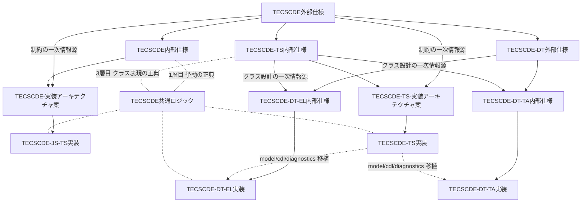

# TECSCDE-仕様関係

## Context
- [[TECSCDE外部仕様]]
- [[TECSCDE内部仕様]]

- [[work/active/TECSCDE共通ロジック/TECSCDE共通ロジック|TECSCDE共通ロジック]]

- [[work/active/tecs/TECSCDE-実装アーキテクチャ案|TECSCDE-実装アーキテクチャ案]]
- [[TECSCDE-JS-TS実装]]
- [[work/active/TECSCDE-TS内部仕様/TECSCDE-TS内部仕様|TECSCDE-TS内部仕様]]
- [[work/active/tecs/TECSCDE-TS-実装アーキテクチャ案|TECSCDE-TS-実装アーキテクチャ案]]
- [[TECSCDE-TS実装]]

- [[work/active/TECSCDE-DT外部仕様/TECSCDE-DT外部仕様|TECSCDE-DT外部仕様]]
- [[work/active/TECSCDE-DT-EL内部仕様/TECSCDE-DT-EL内部仕様|TECSCDE-DT-EL内部仕様]]
- [[TECSCDE-DT-EL実装]]

- [[work/active/TECSCDE-DT-TA内部仕様/TECSCDE-DT-TA内部仕様|TECSCDE-DT-TA内部仕様]]
- [[TECSCDE-DT-TA実装]]

## 依存関係

各ノートの `## Related` の記述から起こした実態ベースの依存関係。

凡例

- 実線 — 仕様・設計の派生／実装対象
- 点線矢印 — コードの移植
- 無向点線 — [[work/active/TECSCDE共通ロジック/TECSCDE共通ロジック|TECSCDE共通ロジック]] が正典・実装として参照する関係

外部仕様から3系統に分岐する。[[TECSCDE内部仕様]]（関数ベース・ブラウザ）、[[work/active/TECSCDE-TS内部仕様/TECSCDE-TS内部仕様|TECSCDE-TS内部仕様]]（クラスベース・ブラウザ）、[[work/active/TECSCDE-DT外部仕様/TECSCDE-DT外部仕様|TECSCDE-DT外部仕様]]（デスクトップ）。DT 系の内部仕様は挙動を DT 外部仕様から、クラス設計を TS 内部仕様から受け取る二重の上流を持つ。

[[work/active/tecs/TECSCDE-実装アーキテクチャ案|TECSCDE-実装アーキテクチャ案]] は [[TECSCDE内部仕様]] と [[TECSCDE-JS-TS実装]] の間に位置する中間ノート。[[work/active/tecs/TECSCDE-TS-実装アーキテクチャ案|TECSCDE-TS-実装アーキテクチャ案]] は [[work/active/TECSCDE-TS内部仕様/TECSCDE-TS内部仕様|TECSCDE-TS内部仕様]] と [[TECSCDE-TS実装]] の間に位置する中間ノート。

## Notes

## Action Items
- [ ]

## Related
- [[work/active/tecs/TECS開発|TECS開発]]
- [[work/Index]]
- [[brain/North Star|North Star]]
