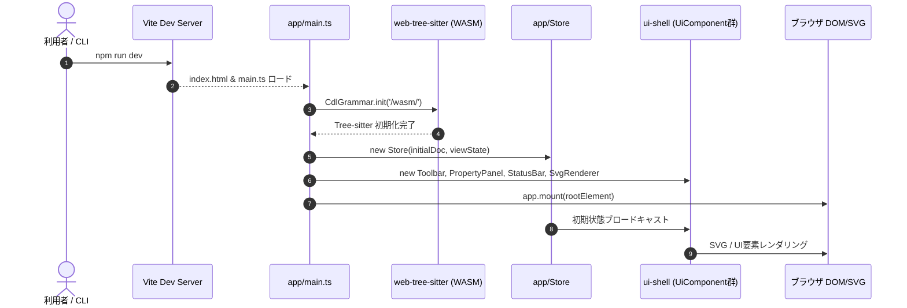

# TECSCDE-TS 実装アーキテクチャ案

> [!info] 位置づけ
> [[TECSCDE-TS内部仕様]]（クラスベースOOP・全11章）および[[TECSCDE外部仕様]]を踏まえ、クラスベースTypeScript実装（`E:\Ccur\typescript\TECSCDE-TS`）のための**具体的なパッケージ構成・型設計・ビルド/実行環境（Vite/開発サーバー）・テスト戦略**を定めた実装アーキテクチャ案。
> 既存の[[work/active/tecs/TECSCDE-実装アーキテクチャ案|TECSCDE-実装アーキテクチャ案]]（関数/interfaceベース・`TECSCDE-JS`向け）に対するクラスベース版の対応文書。

---

## 1. 前提と外部仕様制約

1. **ランタイム依存の極小化（外部仕様 2.2）**:
   - ランタイムの `dependencies` は Tree-sitter WASM バインディング（`web-tree-sitter`）のみ。
   - UIフレームワーク（React/Vue等）や外部描画ライブラリは使用せず、DOM/SVG標準APIおよびクラスベースのUIライフサイクル抽象（`UiComponent`）で構築。
2. **サーバレス・ブラウザ単体完結（外部仕様 2.2 / 2.3）**:
   - バックエンド処理系を持たず、CDL解析・シリアライズ・SVG差分描画・整合性検証をすべてブラウザのメインスレッド上で完結。
3. **ビルド時ツールチェーンとしての Vite / CLI環境**:
   - 開発時のローカルWebサーバー起動（`npm run dev`）、TypeScriptコンパイル＋バンドル（`npm run build`）、単体/結合テスト（`npm run test`）を `devDependencies` の Vite エコシステム（Vite + Vitest）で一元管理。

---

## 2. パッケージ・ディレクトリ構成（9モジュール → `src/` 配置）

[[TECSCDE-TS内部仕様 - 10 モジュール間インタフェース一覧|第10章]]のクラス設計に基づくディレクトリ構成：

```
src/
  model/            (C: ドメインモデル中核。他モジュールへの依存なし)
    types.ts          識別子型 (CellId, PortId, JoinId, RegionId 等)
    port.ts           Port (抽象基底), CPort (呼び口: 結合最大1本), EPort (受け口: 複数結合可)
    cell.ts           Cell (Immutable Class, moveTo/resize/withPorts 等)
    join.ts           Join, JoinBar (Immutable Class, withBars 等)
    region.ts         Region, RegionTree (Immutable Tree)
    document.ts       TecscdeDocument (ルート集約, Mapをprivate隠蔽し不変操作メソッド公開)
    invariants.ts     InvariantViolation (実行時例外型)

  cdl/              (B: CDL文法走査・生成。DOM/SVG非依存)
    cst.ts / grammar.ts   tree-sitter-cdl / tree-sitter-tecs-cdecl (tools-ts版)
    document-builder.ts   CdlDocumentBuilder (CST走査・TecscdeDocument構築)
    serializer.ts         CdlSerializer (TecscdeDocument → CDLテキスト出力)
    tool-info.ts          ToolInfoValidator (__tool_info__ 検証・往復保持)
    fragment.ts           CDL断片シリアライズ/パース (クリップボード用)
    messages.ts           tecsgenメッセージカタログ定数

  commands/         (D: 編集コマンド/Undo-Redo。Cのみに依存)
    command.ts        Command (抽象基底クラス), History (Replayベース線形履歴)
    cell-commands.ts  AddCellCommand, MoveCellCommand, DeleteCellCommand, ...
    join-commands.ts  CreateJoinCommand, MoveJoinBarCommand, DeleteJoinCommand, ...
    clipboard-commands.ts CopyCommand, CutCommand, PasteCommand, ...
    paper-commands.ts ChangePaperCommand, ChangeRegionsCommand, ...

  render/           (E: SVG描画・インタラクション。独自の不変条件を持たない)
    svg-renderer.ts   SvgRenderer (要素属性の差分更新のみ、全体再描画禁止)
    cell-renderer.ts  CellRenderer (セル・ポートSVG要素生成/更新)
    join-renderer.ts  JoinRenderer (直角折れ線パス・結合バー描画)
    hit-test.ts       HitTester (ポート→セル→結合バー優先度判定)
    gesture-controller.ts GestureController (ドラッグFSM → Command発行)

  view-state/       (F: 表示制御。C・Bから独立、.cdeに含めない)
    view-state.ts     ViewState (ズーム・パン・中心固定ズーム)
    filters.ts        DisplayFilters (リージョン/ネームスペースフィルタ)
    region-color.ts   リージョン自動カラーパレット・凡例

  ui-shell/         (G: UIシェル層。UiComponentライフサイクル抽象)
    ui-component.ts   UiComponent (抽象基底クラス: mount/update/destroy)
    toolbar.ts        Toolbar extends UiComponent
    property-panel.ts PropertyPanel extends UiComponent
    palette.ts        Palette extends UiComponent
    status-bar.ts     StatusBar extends UiComponent
    display-control-bar.ts DisplayControlBar extends UiComponent
    navigator.ts      NavigatorComponent extends UiComponent
    dialogs.ts        モーダル抽象・破棄確認・tecsgen提示・エラー一覧

  diagnostics/      (H: B・Cへの読み取り専用オブザーバ)
    types.ts          Diagnostic, DiagnosticReport
    collector.ts      DiagnosticsCollector (警告・エラー集約)
    integrity.ts      IntegrityChecker (未結合呼び口等のモデル整合性検査)
    tecsgen-result-parser.ts TecsgenResultParser (tecsgen CLIエラー出力のパース)

  tecsgen-link/     (I: 葉ノード。非実行・提示のみ)
    command-builder.ts TecsgenCommandBuilder (tecsgen実行コマンド文字列の生成)

  io/               (A: ファイルI/O・エクスポート)
    file-strategy.ts  FileIOStrategy (File System Access API & フォールバック)
    file-opener.ts    FileOpener, FileSaver
    exporter.ts       SvgExporter, PngExporter
    dirty-tracker.ts  DirtyTracker (未保存変更監視)

  app/              (統合・エントリポイント)
    store.ts          Store (C・F・Hを束ねる中央 pub/sub クラス)
    main.ts           Webエントリポイント (DOM初期化・WASMロード・依存注入)
```

---

## 3. 実行環境と CLI / ビルド構成（Viteの役割）

### 3.1 開発時実行とコマンドライン操作
Node.js / npm のスクリプトを通じて、コマンドラインから直ちに開発サーバーやテストを実行可能にします。

```json
{
  "name": "tecscde-ts",
  "version": "0.1.0",
  "type": "module",
  "scripts": {
    "dev": "vite",
    "build": "tsc --noEmit && vite build",
    "preview": "vite preview",
    "test": "vitest run",
    "test:watch": "vitest",
    "typecheck": "tsc --noEmit",
    "depcruise": "depcruise --config .dependency-cruiser.cjs src",
    "check": "npm run typecheck && npm run build && npm run test && npm run depcruise"
  },
  "dependencies": {
    "web-tree-sitter": "^0.22.6"
  },
  "devDependencies": {
    "@types/node": "^22.0.0",
    "dependency-cruiser": "^16.0.0",
    "typescript": "^5.5.0",
    "vite": "^5.4.0",
    "vitest": "^2.0.0"
  }
}
```

### 3.2 HTML / アセット配置構成
* **`index.html`** (プロジェクトルート):
  ```html
  <!DOCTYPE html>
  <html lang="ja">
  <head>
    <meta charset="UTF-8" />
    <meta name="viewport" content="width=device-width, initial-scale=1.0" />
    <title>TECSCDE-TS</title>
    <link rel="stylesheet" href="/src/ui-shell/styles/main.css" />
  </head>
  <body>
    <div id="app"></div>
    <script type="module" src="/src/app/main.ts"></script>
  </body>
  </html>
  ```
* **`public/` (静的アセット配信)**:
  - `public/wasm/`: `tree-sitter.wasm`, `tree-sitter-cdl.wasm`, `tree-sitter-tecs-cdecl.wasm`
  - `public/samples/`: 検証用サンプルCDL（`celltypes.cdl`, `main.cde` 等）

### 3.3 Vite 設定 (`vite.config.ts`)
```typescript
import { defineConfig } from 'vite';
import path from 'path';

export default defineConfig({
  root: '.',
  publicDir: 'public',
  server: {
    port: 5184,
    open: true
  },
  build: {
    outDir: 'dist',
    target: 'es2022',
    sourcemap: true
  },
  resolve: {
    alias: {
      '@': path.resolve(__dirname, './src')
    }
  }
});
```

---

## 4. 起動シーケンス（`src/app/main.ts`）



---

## 5. 品質保証・テスト戦略

| レイヤ | 対象モジュール | テスト手法・ツール | 検証内容 |
|---|---|---|---|
| **モデル不変条件** | `model/` (C) | Vitest | `static create()` / `moveTo()` の ALIGN丸め、呼び口1本制限、クラス不変性 |
| **CDLパーサ・往復** | `cdl/` (B) | Vitest + Fixture | サンプルCDLの parse → serialize 意味的一致、未知 `__tool_info__` 保持 |
| **編集コマンド** | `commands/` (D) | Vitest | コマンド実行、Replay履歴（Undo/Redo）、クリップボードCDL断片往復 |
| **UI・ライフサイクル** | `ui-shell/` (G), `app/` | Vitest + jsdom | `UiComponent` の mount/update/destroy、Storeディスパッチ連携 |
| **モジュール境界** | 全9モジュール | dependency-cruiser | 第2章の依存方向違反（`render` → `model` 直接更新等）の静的検証 |

---

## 6. まとめ

本アーキテクチャ案を採用することで：
1. **[[TECSCDE-TS内部仕様]] のクラスベース設計**（Immutable Class、`UiComponent`）を損なうことなく、
2. **`npm run dev` によるブラウザ自動起動・HMR開発**、
3. **`npm run check` によるワンストップのCI品質検証**
が実現され、現行の関数型実装（`TECSCDE-JS`）と同等の開発・実行環境が確立されます。

---

## Related

- [[TECSCDE-TS内部仕様]] — 本アーキテクチャ案が準拠するクラスベース内部仕様（全11章）
- [[work/active/TECSCDE-TS実装/TECSCDE-TS実装|TECSCDE-TS実装]] — 本アーキテクチャ案に基づく実装進捗ノート
- [[work/active/tecs/TECSCDE-実装アーキテクチャ案|TECSCDE-実装アーキテクチャ案]] — 関数/interfaceベース（TECSCDE-JS）の先行アーキテクチャ案
- [[TECSCDE外部仕様]] — 外部仕様・制約の一次情報源
- [[work/active/tecs/TECS開発|TECS開発]] — 全体開発進捗
